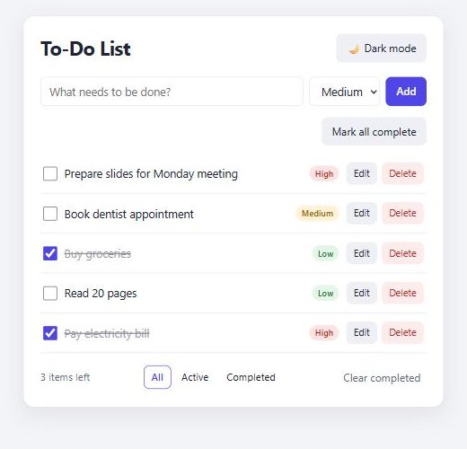
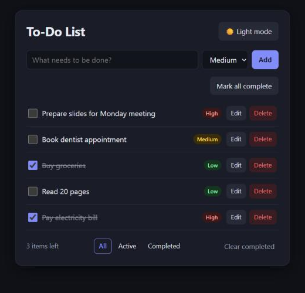
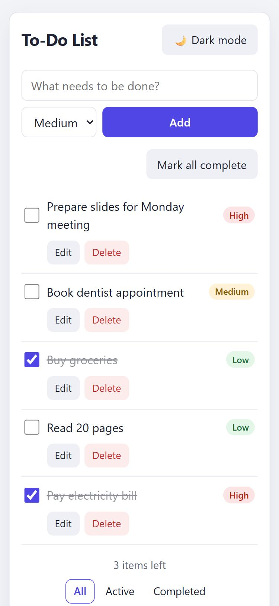

# To-Do List

A fast, clean to-do list that runs entirely in the browser. You can add, complete, edit, prioritize, filter and delete tasks, and everything is saved to `localStorage`. There is no backend and no account.

Built with **React 18** (function components + hooks), bundled with **Parcel 2**, styled with **plain CSS**.

## Screenshots

| Light | Dark | Mobile |
|---|---|---|
|  |  |  |

## Features

- **Add tasks** with the Add button or Enter. Text is trimmed, and empty input shows "Task cannot be empty".
- **Newest first** list with a friendly empty state.
- **Complete / un-complete** tasks with a checkbox. Completed tasks are struck through and faded.
- **Inline edit** with the Edit button or a double-click. Enter or Save saves, Escape or Cancel discards, and empty text is rejected.
- **Delete** single tasks or **Clear completed** (only shown when there are completed tasks).
- **Undo** for 5 seconds after any delete or clear.
- **Filters:** All / Active / Completed, with the selected filter highlighted and an "N items left" counter.
- **Priorities:** Low / Medium / High with colour labels, set when adding or editing.
- **Mark all complete / active** in one click.
- **Dark mode** that follows your system theme the first time, then remembers your choice.
- **Saved automatically** to `localStorage`. Invalid or missing data never crashes the app.
- **Responsive** (phone to desktop) and **keyboard accessible** (labels, visible focus, Escape to cancel).

## Getting started

Requirements: [Node.js](https://nodejs.org/) 18+ and npm.

```bash
npm install
npm start          # dev server on http://localhost:1234
npm run build      # production build in dist/
```

## Project structure

```
src/
├── index.html
├── index.js              # renders <App /> into #root
├── App.js                # state: tasks, filter, editing, theme, undo toast
├── styles.css            # light/dark themes via CSS variables
├── components/
│   ├── TodoInput.js      # add form + validation
│   ├── TodoList.js       # list + empty states
│   ├── TodoItem.js       # view / edit modes
│   ├── FilterBar.js      # counter, filters, clear completed
│   ├── PrioritySelect.js # priority select + badge
│   ├── ThemeToggle.js
│   └── Toast.js          # undo toast
└── utils/
    ├── storage.js        # safe localStorage load/save + validation
    └── tasks.js          # task factory, filtering, labels
```

## Data

Each task is stored as `{ id, text, completed, priority, createdAt }` under the `todo-list.tasks` key. The theme is stored under `todo-list.theme`.
